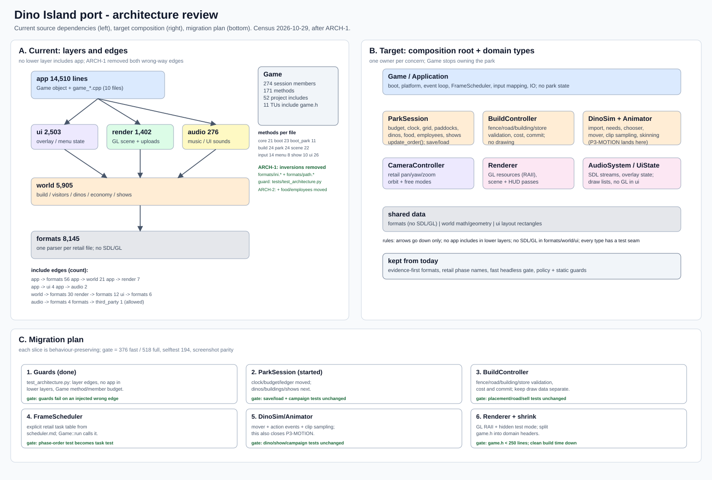

# Port architecture (2026-10-29 review)

Status: **ARCH-1 landed; ARCH-2 in progress (first slice).** This page
is the architecture view: what the source looks like now, where the coupling
is, and the order in which the remaining `Game` responsibilities move out.
The file/phase map is `app-shell.md`; the C++ rules are `cpp-guidelines.md`.

## Method

- `notes/harness/architecture_census.py` counted explicit project `#include`
  edges between `src/app`, `src/ui`, `src/world`, `src/render`, `src/audio` and
  `src/formats`, and the `class Game` declarations/methods.
- Line counts are first-party `src/<layer>/**/*.{h,cpp}`; `third_party/` and
  the 32-bit `hook/` proxy are excluded.
- The layer rules are enforced only in part today:
  `test_app_shell.py` rejects SDL/GL in `formats`/`world`/`ui`, and
  `test_cpp_style.py` covers C++ style; there is no dependency-direction test.

## Current census

| Layer | Lines | Share | Role today |
| --- | ---: | ---: | --- |
| `app` | 14,510 | 44% | `Game`, boot/frame phases, **plus** build/park/scene/show/input/UI drawing |
| `formats` | 8,145 | 25% | one parser per retail file; no SDL/GL |
| `world` | 5,905 | 18% | build, visitors, dinos, economy, shows, campaign |
| `ui` | 2,503 | 8% | overlay/menu/park widget state |
| `render` | 1,402 | 4% | GL scene, uploads, shaders |
| `audio` | 276 | 1% | music + UI sounds |

`Game` is the architectural centre of gravity: **266 data members, 171
methods**, declared in a **665-line `game.h` with 49 project includes**. All
**11** `src/app/*.cpp` translation units include that header, so every domain
change recompiles the whole app layer.

### Include edges (explicit, count)

| From → to | Count | Comment |
| --- | ---: | --- |
| `app → formats` | 56 | expected |
| `app → world` | 21 | expected |
| `app → render` | 7 | expected |
| `app → ui` | 4 | expected |
| `app → audio` | 2 | expected |
| `world → formats` | 30 | expected |
| `render → formats` | 12 | expected |
| `ui → formats` | 6 | expected |
| `audio → formats` | 4 | expected |
| `formats → third_party` | 1 | `pl_mpeg` decoder |

No lower layer includes `app`, and no first-party lower layer uses SDL/GL:
the core is genuinely portable. **ARCH-1 removed the two inversions**
(`formats → ui`, `audio → world`) and added a guard that fails on any new
wrong-way edge.

## Findings

| # | Severity | Finding | Evidence |
| --- | --- | --- | --- |
| A1 | **High** | `Game` is a god object: it owns park, economy, visitors, dinos, build, show, camera, UI, render and audio state, and the frame order. `ParkSession` now exists, but only clock/budget/sellback/ledger, the build grid/paddocks, the visitor system/profiles, food/employees, the show runtime/catalog and the placed buildings/entrance state live there. | 266 members, 171 methods, 11 TUs include `game.h` |
| A2 | **High** | Domain logic lives in the app layer: `game_build.cpp` (1,037), `game_park.cpp` (1,262), `game_scene.cpp` (855), `game_show.cpp` (390). Only the data types are in `world`. | layer/census; app is 44% of first-party code |
| A3 | Medium | Two dependency inversions: `formats → ui` (`ui::IniFile`) and `audio → world` (`asset_path` in `vegetation.h`). **Fixed by ARCH-1**: parser moved to `formats/ini.*`, path helper to `formats/path.*`. | include census; `tests/test_architecture.py` |
| A4 | Medium | The frame order is implicit in `Game::run()` and the phase bodies, not represented as retail tasks (`lpScheduler`); two phase names mislead (`update_audio` does minimap zoom, `update_diagnostics` refills a WAV). | `game.cpp` phase list; `app-shell.md` notes |
| A5 | Medium | `game.h` is the build bottleneck: 49 project includes, 11 TUs. Splitting it requires the state boundary from A1. | header census |
| A6 | Medium | UI layout/state (`ui`) and UI drawing (`app/game_ui.cpp`, 1,500) are split across layers with no draw-list seam; every new panel couples to GL and `Game`. | `game_ui.cpp`, `ui/*` |
| A7 | Low | GL names (`GpuMesh`, `GLuint` textures) are copyable, manual-destroy handles; the owner is `Game` and the deleter needs `GlFns`. | `render/mesh_gpu.h`; policy deviation row |
| A8 | Low | No unit-test seam for `Game` (private phase methods, non-copyable); the only automated proof is the CLI/screenshot suite. | `tests/test_app_cpp.py`, `test_app_shell.py` |
| A9 | Medium | `ImportedDino`/`ImportedSpecies` mix simulation state (needs/attributes/action_loop/position) with GL state (`GpuMesh`, `GLuint texture`). Moving them into `ParkSession` would make `world` depend on GL, so the dino slice is deferred to ARCH-5 after the type split. | `game.h` nested types; layer guard |

Strengths to keep: the lower layers are SDL/GL-free, the format layer has one
parser per file with evidence, the 21 boot / 14 frame phases are named, the
fast gate is now truly headless, and the static guards are mutation-tested.

## Review P1s closed

- **Simulation delta:** `Game::advance_time` caps the frame delta at 0.2 s
  (retail `lpScheduler`; `docs/decomp/scheduler.md:45`), so a stalled frame
  cannot jump the park clock, needs, visitors or employees by seconds.
- **Save integrity:** `formats/atomic_file.{h,cpp}` writes `<path>.tmp`,
  flushes and checks the stream, renames on commit and removes the temp file
  on abort. The port save, campaign unlock and campaign progress use it; the
  overwrite test asserts that no `.tmp` is left behind.

## Target composition

`Game` becomes a **composition root** (boot, platform, event loop, input, IO)
and owns these domain types, each with a narrow interface:

| Type | Owns | Interface |
| --- | --- | --- |
| `ParkSession` | budget/clock, build grid, paddocks, dinos, food, employees, shows, visitors | `update(dt)`, `load_state`/`save_state` |
| `BuildController` | fence/road/building/store validation, cost, commit | `try_place_*`, `sell_*`, `preview()` |
| `DinoSim` + `DinoAnimator` | needs/chooser/mover and clip selection/sampling/skinning | `update(dt)`, `pose()` |
| `CameraController` | retail pan/yaw/zoom, orbit/free modes | `update(input)`, `view()` |
| `FrameScheduler` | the retail task table and order | `run_tasks(dt)` |
| `Renderer` | GL resources (RAII), scene/HUD passes | `draw(state)` |
| `AudioSystem` | SDL streams, music/SFX | `update()`, `play()` |
| `UiState` | overlay/menu/park widget state and draw lists | `update(input)`, `build_draw_list()` |

Rules: arrows point down only; `formats`/`world`/`ui` stay SDL/GL-free;
`Game` holds no park data after the migration; each type can be constructed
without a window.

## Migration plan

Each phase is behaviour-preserving and ends at the same gate: `--selftest`
194, fast 379, full 521, plus screenshot parity for the HUD/park shots. The
task queue is `TASKS.md` ARCH-1..6.

| Phase | Work | Output | Gate |
| --- | --- | --- | --- |
| **ARCH-1** | **Done.** Architecture guards: `tests/test_architecture.py` for the layer matrix, no lower→app, a `Game` member/method/header budget (286/171/700) and the phase map. Moved `asset_path` to `formats/path.*` and the INI parser to `formats/ini.*`. | zero inversions; guard fails on an injected wrong edge | fast 379 |
| **ARCH-2** | `ParkSession` state: move the park/economy/visitor/dino/build/show fields out of `Game` into `world/park_session.{h,cpp}`. Slices done: clock/budget/sellback/ledger, the build grid and paddocks, then the visitor system and profiles, then food/employees, then the show runtime/catalog, then buildings/entrance (266 members). `advance_clock`/`update_staff` and `settle_day` now live on `ParkSession`; the show tick follows the dino split (it needs `imported_dinos`), and dino state is deferred to ARCH-5 because the type mixes simulation and GL state (A9). | save/load and campaign tests unchanged; `game.h` shrinks | full 521 |
| **ARCH-3** | `BuildController` + `CameraController`: move placement/validation/cost and the camera equations behind the new types; keep the draw data in `Game`/`Renderer`. | placement/road/sell tests unchanged | full 521 |
| **ARCH-4** | `FrameScheduler`: a table of named tasks in the retail order from `docs/decomp/scheduler.md`; `Game::run()` calls `scheduler.run_tasks(dt)`; phase-order test becomes task-order test. | order is data, not statement position | fast 379 |
| **ARCH-5** | `DinoSim` + `DinoAnimator`: first split `ImportedDino`/`ImportedSpecies` into world simulation state and render assets, then move needs/chooser/mover and clip selection/sampling/skinning out of `Game`; this is also the P3-MOTION functional gap. | dino/show/campaign tests unchanged | full 521 |
| **ARCH-6** | `Renderer` + `AudioSystem`: GL RAII (or a documented owner), hidden capture mode, split `game.h` into domain headers; `Game` < 250 lines. | no GL in `Game`; clean build time down | full 521 |

Sequencing rationale: guards first so every move is checked; state before
behaviour so the update order has a home; scheduler after state/controllers to
avoid moving order twice; dino sim as the functional payoff; renderer last
because the GL risk is highest and the hidden-window mode benefits the tests.

Risks: behavior parity (verbatim moves + the 518-test gate), merge conflicts
(single lane, one phase at a time), compile-time churn while `game.h` is still
large (split last), and screenshot drift (compare the tracked HUD shots after
ARCH-2/3/5).

## Non-goals

- Do not rewrite the format readers or the retail-value math.
- Do not change the rendered result or save bytes; this is a structural move.
- Do not move the 32-bit `src/hook` proxy or the vendored decoders.
